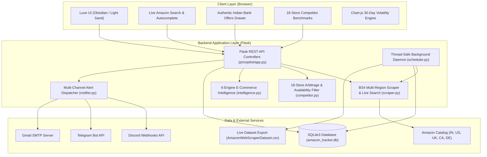
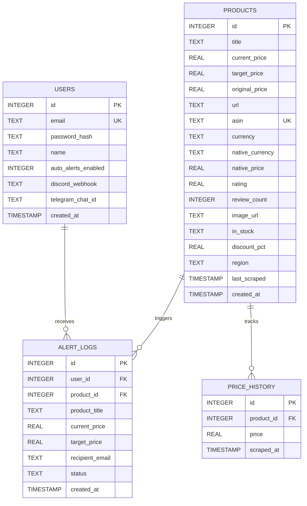

# <p align="center"></p>

<p align="center">
  <strong>Autonomous E-Commerce Price Intelligence, Cross-Store Arbitrage & Multi-Channel Alerting Platform</strong>
</p>

<p align="center">
  <em>TRACK. COMPARE. MAKE THE MOVE.</em>
</p>

<p align="center">
  
  
  
  
  
  
  
  
</p>

---

> **Architect & Lead Engineer**: **Jai S Ramani**  
> 📧 **Email**: [jaisramani05@gmail.com](mailto:jaisramani05@gmail.com) | 💼 **LinkedIn**: [jai-s-ramani-2948532bb](https://www.linkedin.com/in/jai-s-ramani-2948532bb) | 🐙 **GitHub**: [Jai-S-Ramani](https://github.com/Jai-S-Ramani)

---

## 📌 Table of Contents

- [Overview](#-overview)
- [Official Brand Identity](#-official-brand-identity)
- [Key Architectural Capabilities](#-key-architectural-capabilities)
  - [1. Real-Time Amazon Catalog Search & Predictive Autocomplete](#1-real-time-amazon-catalog-search--predictive-autocomplete)
  - [2. 18-Store Competitor Arbitrage Engine](#2-18-store-competitor-arbitrage-engine)
  - [3. Intelligent Dealer Catalog Availability Filter](#3-intelligent-dealer-catalog-availability-filter)
  - [4. Authentic Amazon India Bank Offers Drawer & Dynamic FX Engine](#4-authentic-amazon-india-bank-offers-drawer--dynamic-fx-engine)
  - [5. 6-Engine E-Commerce Intelligence Suite](#5-6-engine-e-commerce-intelligence-suite)
  - [6. Multi-Channel Alert Dispatcher (Discord, Telegram, Email)](#6-multi-channel-alert-dispatcher-discord-telegram-email)
  - [7. Autonomous Background Daemon Scheduler](#7-autonomous-background-daemon-scheduler)
  - [8. Minimalist Dual-Theme UI & Spring Animation Physics](#8-minimalist-dual-theme-ui--spring-animation-physics)
- [System Architecture](#-system-architecture)
- [Repository Structure](#-repository-structure)
- [Database Schema & Data Pipeline](#-database-schema--data-pipeline)
- [REST API Reference](#-rest-api-reference)
- [Automated Test Suite (59 Tests)](#-automated-test-suite-59-tests)
- [Quickstart & Deployment Guide](#-quickstart--deployment-guide)
  - [Local Installation](#1-local-installation)
  - [Running the Application](#2-running-the-application)
  - [Docker & Containerized Deployment](#3-docker--containerized-deployment)
  - [Render.com Cloud Deployment](#4-rendercom-cloud-deployment)
- [Attribution & Credits](#-attribution--credits)

---

## 📖 Overview

**PricePilot** is an enterprise-grade, full-stack E-Commerce Price Intelligence, Cross-Store Arbitrage, and Predictive Market Analytics Platform. It transforms static web scraping into a continuous, autonomous decision-support command center.

PricePilot tracks products across 5 international Amazon regions (defaulting to Amazon India `IN`), benchmarks real-time pricing across **18 leading Indian and Global marketplaces**, filters out non-carrying dealers dynamically, computes historical price volatility, dispatches rich alerts across Email, Discord, and Telegram, and calculates partner card discounts with authentic bank terms.

---

## 💎 Official Brand Identity

**PricePilot** is defined by a bold, high-tech visual identity:

- **The 3D Master Emblem**: A precision obsidian capital **'P'** unified with a dual-bar volume chart and sliced diagonally by a faceted, luminous emerald-green price drop arrow.
- **Wordmark & Typography**: **Price<span style="color:#10b981">Pilot</span>** featuring obsidian/white primary typography and a radiant emerald gradient (`#10b981` &rarr; `#00e676`).
- **Official Tagline**: `TRACK. COMPARE. MAKE THE MOVE.`
- **Theme-Adaptive Assets**:
  - `pricepilot/static/images/pricepilot_brand_dark.png`: Custom dark mode logo with metallic chrome specular reflections, glowing emerald aura, and translucent luminance alpha blending.
  - `pricepilot/static/images/pricepilot_brand_light.png`: Optimized for light themes with obsidian "Price" and vibrant emerald "Pilot".
  - `pricepilot/static/images/pricepilot_exact_square.png`: 1024×1024 master square dark-mode brand mark.
  - `pricepilot/static/images/logo.png` & `logo.svg`: High-resolution master favicon and vector brand assets.

---

## ✨ Key Architectural Capabilities

### 1. Real-Time Amazon Catalog Search & Predictive Autocomplete
- **Live Catalog Search**: Search products directly across Amazon's catalog without manually finding URLs or ASINs.
- **Direct Target Alert Price Input**: Set your desired alert price directly within the live search interface before tracking, instantly establishing your threshold.
- **Predictive Autocomplete**: Instant search suggestions as you type with debounced querying (220ms), keyboard navigation (Up/Down arrows + Enter), and outside-click dismiss.
- **Indian Marketplace Default**: Configured to default to Amazon India (`IN`) and Indian Rupee (`₹` / `INR`) with quick regional switching (US, UK, CA, DE).
- **1-Click Track Item**: Search result cards include verified imagery, ratings, pricing, and a 1-click `+ Track Item` button that seamlessly registers the product into SQLite monitoring.

### 2. 18-Store Competitor Arbitrage Engine
- **18 Marketplaces Benchmarked with Official Brand Logos**:
  - **Indian Mega & Tech**: Flipkart, Croma (Tata Group), Reliance Digital, Tata CLiQ, JioMart, Meesho
  - **10-Min Quick Commerce**: Blinkit, Zepto, Swiggy Instamart, BigBasket (Tata)
  - **Fashion & Beauty**: Myntra, AJIO (Reliance), Nykaa
  - **Global & US Retail**: Walmart, Best Buy, eBay, Target, B&H Photo Video
- **Arbitrage Verdict Banner**: Instantly highlights whether Amazon or a competitor holds the lowest market price, along with maximum savings and total market price spread.
- **Interactive Sector Tabs & Channel Pills**: Switch between Indian and Global retail tabs or filter by channels (*All Stores*, *Fashion & Beauty*, *10-Min Quick Commerce*, *Electronics & Mega*).
- **Market Price Spread Visualizer**: Relative percentage bars display price distribution across all carrying stores with a Best Price trophy badge.

### 3. Intelligent Dealer Catalog Availability Filter
- **Real-World Category Mapping**:
  - **Quick Commerce (Zepto, Blinkit, Instamart, BigBasket)**: Actively stocks audio earbuds (OnePlus Buds, boAt), tech accessories, phone chargers, daily grooming, and groceries.
  - **Electronics Specialists (Croma, Reliance Digital, Best Buy, B&H Photo)**: Dedicated to audio, tech, laptops, phones, and appliances.
  - **Pure Fashion Specialists (Myntra, AJIO)**: Strictly apparel and footwear; completely excludes audio/electronics.
  - **Pure Cosmetics & Beauty Specialist (Nykaa)**: Strictly cosmetics and skincare; completely excludes tech/earbuds.
- **Interactive "In-Stock & Carried Only" Toggle**:
  - **Enabled by Default**: Automatically hides platforms that do not sell the product category (e.g., viewing OnePlus Buds hides Nykaa, Myntra, and AJIO).
  - **Catalog Filter Notice Banner**: Explains which dealers were excluded and why (e.g., *Catalog Filter Active: 3 dealer(s) (Nykaa, Myntra, AJIO) hidden because they do not carry audio*).
  - **Uncarried Muted State**: Toggling the filter off renders excluded stores with dashed borders, low opacity, a red `⊘ Not Sold Here` badge, and disabled CTAs.
- **Protected Spread Analytics**: Non-carrying stores are strictly excluded from winner calculations and spread metrics so unavailable dealers never distort market pricing.

### 4. Authentic Amazon India Bank Offers Drawer & Dynamic FX Engine
- **Exact Amazon India Drawer Layout**: Recreated the authentic modal/bottom-sheet layout with 5 genuine offer tiers:
  - **Offer 1**: `10% Instant Discount up to INR [cap] on [Bank] Credit Card EMI Trxn. Min purchase value INR [min].00`
  - **Offer 2**: `10% Instant Discount up to INR [cap] on [Bank] Credit Card Non-EMI Trxn. Min purchase value INR [min].00`
  - **Offer 3**: `Additional [cap] Instant Discount on [Bank] Credit Card 24 month EMI Txn. Mini purchase value INR [min].00 . Add Amazon Upgrade+ to the cart along with the [item] and avail the discount. Shop items`
  - **Offer 4**: `10% Instant Discount up to INR [cap] on [Bank] Debit Card Non-EMI Trxn. Min purchase value INR [min].00`
  - **Offer 5**: `5% Unlimited Cashback on Amazon Pay ICICI Card for Prime members. No minimum spend value.`
- **Interactive `[Apply]` Action**: Instant card selection directly within the drawer, calculating the effective net price with immediate visual feedback and toast notifications.
- **Inline Terms & Conditions**: Clicking `See details >` smoothly expands specific bank terms and conditions inline.
- **Multi-Currency FX Engine (7 Currencies)**:
  - Exact currency conversions across `INR (₹)`, `USD ($)`, `EUR (€)`, `GBP (£)`, `CAD (CA$)`, `AUD (A$)`, and `JPY (¥)`.
  - USD items dynamically convert to rupees without heuristic bypass errors ($15.00 &rarr; ₹1,252.50; $16.99 &rarr; ₹1,418.67).
  - Native Indian products retain their verified rupee pricing (₹3,399.00).

### 5. 6-Engine E-Commerce Intelligence Suite
- **Deceptive Pricing Detection**: Flags artificial markups where retailers inflate list prices right before a "sale" discount.
- **AI Review Authenticity & Sentiment Grading**: Computes an A–D Trust Grade, sentiment breakdown (positive, neutral, critical), verified purchaser percentage, and AI consensus highlights.
- **Price Drop Probability Forecaster**: Evaluates 30-day volatility and historical support levels to project 7–14 day price drop probability scores (0% – 100%).
- **Multi-Store Basket Arbitrage Splitter**: Optimizes multi-item cart purchases across competing stores to find the lowest possible split-order total.
- **Net Price Engine**: Computes true out-of-pocket price factoring in partner bank card instant discounts.
- **Predictive Decision Signals**: Generates automated signals (`BUY_NOW`, `FAIR_PRICE`, `WAIT`) driven by 30-day moving averages and historical lows.

### 6. Multi-Channel Alert Dispatcher (Discord, Telegram, Email)
- **Discord Rich Embeds**: Pushes emerald green (`#10B981`) embed cards to your Discord channel featuring product thumbnails, price drops, target comparisons, and direct store links.
- **Telegram Push Alerts**: Delivers clean Markdown push alerts with bold price deltas, formatted timestamps, and one-tap store redirects.
- **HTML Email Engine**: Sends modern responsive HTML emails with price history sparklines and target price alerts via Gmail SMTP (with automatic fallback to interactive in-browser simulation).

### 7. Autonomous Background Daemon Scheduler
- **Isolated Thread Daemon**: Thread-safe `BackgroundPriceScheduler` daemon sweeps monitored items every 30 minutes (configurable via UI from 5m to 24h).
- **Time-Series Syncing**: Records timestamped price points to SQLite and continuously syncs to [`AmazonWebScraperDataset.csv`](file:///e:/DATA%20ANALYTICS/PortfolioProjects/AmazonWebScraperDataset.csv).
- **Zero UI Blocking**: Operates entirely in a non-blocking background thread with live telemetry exposed via `/api/scheduler/status`.

### 8. Minimalist Dual-Theme UI & Spring Animation Physics
- **Obsidian Dark & Light Sand Themes**: 1-click theme toggle available on both the landing page and the dashboard.
- **GSAP 3 Micro-Interactions**: Rolling numeric counters, spring pop-up physics, focus glow beams, and buttery smooth drawer slide-ins.
- **Interactive Chart.js Analytics**: 30-day historical time-series charts with localized `en-IN` currency tooltips, dual-axis zoom, and SVG sparklines.

---

## 🏗️ System Architecture



---

## 📁 Repository Structure

```
PricePilot/
├── AmazonWebScraperDataset.csv       # Live synchronized CSV dataset export
├── run_original_scraper.py          # Standalone runner for single-item command-line scraper
├── architecture.html                # Interactive standalone system architecture diagram
├── pricepilot.architecture.json     # Architecture specification model
├── docker-compose.yml               # Multi-container orchestration config
├── DEPLOYMENT.md                    # Cloud deployment guide (Render, Docker, Railway)
├── requirements.txt                 # Root Python dependencies
├── README.md                        # Master repository documentation
└── pricepilot/                      # Production Application Package
    ├── app.py                       # REST API controllers, session auth & Flask routes
    ├── scheduler.py                 # Thread-safe BackgroundPriceScheduler daemon
    ├── scraper.py                   # Multi-region BS4 scraper, live search & suggestion engine
    ├── competitor.py                # 18-store competitor comparison & catalog availability engine
    ├── intelligence.py              # 6-engine e-commerce intelligence & Indian bank offers engine
    ├── database.py                  # SQLite database manager, analytics & seed pipelines
    ├── notifier.py                  # Email, Discord webhook & Telegram notification engine
    ├── wsgi.py                      # Production WSGI entry point
    ├── Dockerfile                   # Production container definition
    ├── DEPLOYMENT.md                # Cloud deployment procedures
    ├── requirements.txt             # Application dependencies
    ├── amazon_tracker.db            # Production SQLite3 database
    ├── README.md                    # Detailed application package documentation
    ├── tests/
    │   ├── test_all_features.py     # Base test suite (24 tests)
    │   ├── test_advanced_features.py# Search, notification & export tests (19 tests)
    │   └── test_intelligence_suite.py # 6-engine intelligence suite tests (16 tests)
    ├── static/
    │   ├── css/
    │   │   ├── styles.css           # Obsidian Briar & Warm Biscuit design system
    │   │   └── landing.css          # Landing page styles & typography
    │   ├── js/
    │   │   ├── app.js               # Client controller, search autocomplete, GSAP & Chart.js
    │   │   └── landing.js           # Landing page animations, fast demo login & theme toggle
    │   └── images/
    │       ├── logo.svg             # Application vector brand mark
    │       ├── logo.png             # Master 1024x1024 favicon & brand icon
    │       ├── pricepilot_brand_dark.png # Master dark mode brand mark
    │       ├── pricepilot_brand_light.png# Master light mode brand mark
    │       ├── pricepilot_exact_square.png# Master 1024x1024 square brand asset
    │       ├── product-placeholder.svg # Luxury 3D isometric SVG fallback
    │       ├── products/            # 14 verified high-res local product photography assets
    │       └── retailers/           # 18 official SVG brand logos for competitor stores
    └── templates/
        ├── index.html               # Main dashboard with live search & competitor modals
        └── landing.html             # High-conversion landing page & authentication portal
```

---

## 🗄️ Database Schema & Data Pipeline

PricePilot utilizes an optimized SQLite3 database with Write-Ahead Logging (`PRAGMA journal_mode=WAL`) and foreign key constraints enabled.



---

## 🔌 REST API Reference

### Live Search & Catalog Endpoints
| Endpoint | Method | Description |
| :--- | :--- | :--- |
| `GET /api/search` | `GET` | Searches live Amazon catalog by query and region (`q`, `region`, `limit`) |
| `GET /api/search/suggestions` | `GET` | Returns predictive autocomplete keywords (`q`, `region`) |

### Core Product & Analytics Endpoints
| Endpoint | Method | Description |
| :--- | :--- | :--- |
| `GET /` | `GET` | Renders high-conversion landing page |
| `GET /dashboard` | `GET` | Renders main Price Intelligence Dashboard |
| `GET /api/products` | `GET` | Returns all monitored products with signals, sparklines & volatility |
| `POST /api/products/add` | `POST` | Scrapes Amazon URL/ASIN or accepts search payload with `target_price` |
| `DELETE /api/products/<id>` | `DELETE` | Purges tracked item and its historical time-series data |
| `POST /api/products/<id>/target-price` | `POST` | Updates target alert threshold price |
| `POST /api/products/<id>/refresh` | `POST` | Re-scrapes and refreshes price for an individual product |
| `POST /api/products/scrape-all` | `POST` | Triggers immediate batch scrape across all products |
| `GET /api/products/<id>/history` | `GET` | Returns 30-day time-series data formatted for Chart.js |
| `GET /api/products/<id>/export/csv` | `GET` | Exports historical price records for a specific product as CSV |
| `GET /api/products/<id>/export/json` | `GET` | Returns complete price telemetry and deal score analysis as JSON |
| `GET /api/kpis` | `GET` | Returns portfolio-wide aggregate savings & deal KPIs |
| `GET /api/export/csv` | `GET` | Streams synchronized `AmazonWebScraperDataset.csv` |
| `GET /api/export/json` | `GET` | Streams entire portfolio intelligence dataset in structured JSON |

### Multi-Store Competitor Endpoints
| Endpoint | Method | Description |
| :--- | :--- | :--- |
| `GET /api/products/<id>/competitors` | `GET` | Returns real-time pricing across 18 Indian and Global stores with catalog availability flags and arbitrage summary |

### Scheduler & Automation Endpoints
| Endpoint | Method | Description |
| :--- | :--- | :--- |
| `GET /api/scheduler/status` | `GET` | Returns scheduler running state, interval, next sweep time, and run count |
| `POST /api/scheduler/toggle` | `POST` | Toggles background scheduler between running and paused |
| `POST /api/scheduler/interval` | `POST` | Updates cycle interval (`{"minutes": 45}`) |
| `POST /api/scheduler/trigger` | `POST` | Triggers immediate background sweep cycle |

### Authentication & Multi-Channel Alert Endpoints
| Endpoint | Method | Description |
| :--- | :--- | :--- |
| `POST /api/auth/register` | `POST` | Registers a new user account |
| `POST /api/auth/login` | `POST` | Authenticates user credentials and initiates session |
| `POST /api/auth/logout` | `POST` | Terminates active user session |
| `GET /api/auth/me` | `GET` | Returns authenticated user profile, alert preferences & webhooks |
| `POST /api/notifications/settings` | `POST` | Updates Discord webhook and Telegram chat configuration |
| `POST /api/notifications/test-discord` | `POST` | Sends a test Discord embed notification |
| `POST /api/notifications/test-telegram` | `POST` | Sends a test Telegram Markdown message |
| `POST /api/alerts/test` | `POST` | Sends live test email alert or generates simulated HTML preview |
| `GET /api/alerts/history` | `GET` | Returns audit log of sent alert notifications |

---

## 🧪 Automated Test Suite (59 Tests)

The repository features **59 automated unit and integration tests** organized into three specialized test suites:
- [`tests/test_all_features.py`](file:///e:/DATA%20ANALYTICS/PortfolioProjects/pricepilot/tests/test_all_features.py) (24 tests): Scraper parsing, 18-store competitor benchmarking, catalog availability engine, predictive signals, background scheduler, and Flask endpoints.
- [`tests/test_advanced_features.py`](file:///e:/DATA%20ANALYTICS/PortfolioProjects/pricepilot/tests/test_advanced_features.py) (19 tests): Live Amazon catalog search, suggestion autocompletion, target price setting, Discord webhook embeds, Telegram push alerts, multi-channel dispatch, single-product live refresh, and multi-format CSV/JSON exports.
- [`tests/test_intelligence_suite.py`](file:///e:/DATA%20ANALYTICS/PortfolioProjects/pricepilot/tests/test_intelligence_suite.py) (16 tests): Deceptive price detection, AI review authenticity & sentiment breakdown, price drop probability forecaster, multi-store split basket arbitrage optimizer, stacked coupons, and authentic Indian partner bank card discount calculations.

### Running the Full Test Suite:
```bash
python -m unittest discover -s pricepilot/tests -p "test_*.py"
```

```
----------------------------------------------------------------------
Ran 59 tests in 2.85s

OK
```

---

## 🚀 Quickstart & Deployment Guide

### 1. Local Installation

```bash
# Clone the repository
git clone https://github.com/Jai-S-Ramani/PricePilot.git
cd PricePilot

# Install dependencies
python -m pip install -r requirements.txt
```

### 2. Running the Application

```bash
# Launch the PricePilot application
python pricepilot/app.py
```
- Open **[`http://127.0.0.1:5000/`](http://127.0.0.1:5000/)** for the Landing Page & 1-Click Instant Demo.
- Open **[`http://127.0.0.1:5000/dashboard`](http://127.0.0.1:5000/dashboard)** for the Main Price Intelligence Command Center.

### 3. Docker & Containerized Deployment

Run PricePilot with persistent SQLite storage in one command:
```bash
docker-compose up --build -d
```
- The dashboard is immediately accessible on **`http://localhost:5000`**.
- Database records persist across container restarts in `./pricepilot/amazon_tracker.db`.

### 4. Render.com Cloud Deployment

1. Push your repository to GitHub.
2. In Render, select **New +** $\to$ **Web Service**.
3. Set **Root Directory** to `pricepilot`.
4. Set **Build Command** to `pip install -r requirements.txt`.
5. Set **Start Command** to `gunicorn --workers=4 --bind=0.0.0.0:$PORT app:app`.
6. Set **Health Check Path** to `/api/health`.

---

## 📜 Attribution & Credits

- **Architect & Lead Developer**: **Jai S Ramani**
  - 📧 **Email**: [jaisramani05@gmail.com](mailto:jaisramani05@gmail.com)
  - 💼 **LinkedIn**: [https://www.linkedin.com/in/jai-s-ramani-2948532bb](https://www.linkedin.com/in/jai-s-ramani-2948532bb)
  - 🐙 **GitHub**: [https://github.com/Jai-S-Ramani](https://github.com/Jai-S-Ramani)
- **Official Brand Mark**: **PricePilot** — *TRACK. COMPARE. MAKE THE MOVE.*
- **Tech Stack**: Python 3.9+, Flask, BeautifulSoup4, SQLite3, Chart.js, GSAP 3, FontAwesome 6, Google Fonts (Inter, Outfit, JetBrains Mono).
