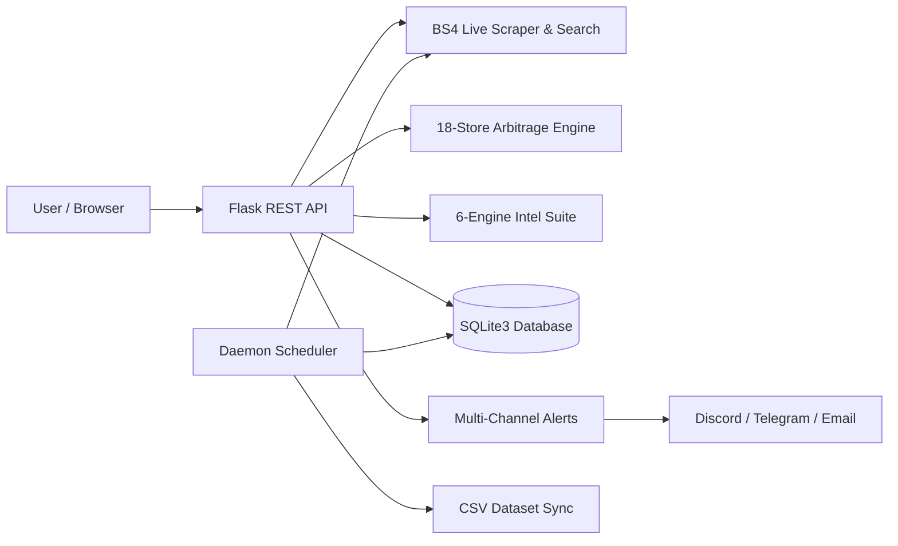

# <p align="center"></p>

<p align="center">
  <strong>Autonomous E-Commerce Price Intelligence, Cross-Store Arbitrage & Multi-Channel Alerting Platform</strong>
</p>

<p align="center">
  <em>TRACK. COMPARE. MAKE THE MOVE.</em>
</p>

<p align="center">
  
  
  
  
  
  
  
  
</p>

---

> **Architect & Lead Engineer**: **Jai S Ramani**  
> 📧 [jaisramani05@gmail.com](mailto:jaisramani05@gmail.com) | 💼 [LinkedIn](https://www.linkedin.com/in/jai-s-ramani-2948532bb) | 🐙 [GitHub](https://github.com/Jai-S-Ramani)

---

## 📸 Visual Showcase

### 1. Command Center Dashboard
> Real-time price tracking, 30-day interactive SVG sparklines, deal scores, and automated buying signals (`BUY NOW`, `FAIR PRICE`, `WAIT`).

<p align="center">
  
</p>

---

### 2. Live Amazon Catalog Search & Predictive Autocomplete
> Direct Amazon catalog search with instant debounced keyword suggestions, region selector (defaulting to 🇮🇳 India), and 1-click tracking.

<p align="center">
  
</p>

---

### 3. 18-Store Competitor Arbitrage & Catalog Filter
> Live benchmark across **13 Indian marketplaces** (Flipkart, Croma, Reliance Digital, Tata CLiQ, Blinkit, Zepto, etc.) and **5 Global retailers** (Walmart, Best Buy, eBay, Target, B&H) with category-availability filtering.

<p align="center">
  
</p>

---

### 4. Authentic Amazon India Bank Offers & FX Engine
> 5 authentic card EMI / debit / cashback tiers with inline terms expansion and exact currency conversions ($15 &rarr; ₹1,252.50).

<p align="center">
  
</p>

---

### 5. 30-Day Volatility & Predictive Price Drop Forecaster
> Interactive Chart.js time-series analytics, 7–14 day price drop probability (0–100%), and CSV/JSON export actions.

<p align="center">
  
</p>

---

### 6. High-Conversion Landing Page
> Obsidian Dark & Light Sand themes with instant 1-Click Guest Demo access.

<p align="center">
  
</p>

---

## ⚡ Core Capabilities

- 🔍 **Live Catalog Search**: Search Amazon directly without pasting URLs; set target alert prices upfront.
- 🏪 **18-Store Arbitrage Engine**: Compares prices across 13 Indian + 5 Global retailers with spread analytics.
- 🏷️ **Catalog Availability Filter**: Dynamically excludes stores that do not stock a category (e.g. Nykaa for tech).
- 💳 **Amazon Bank Offers**: Calculates partner card discounts with authentic terms and effective net pricing.
- 💱 **Multi-Currency FX (7 Currencies)**: Full support for `INR (₹)`, `USD ($)`, `EUR (€)`, `GBP (£)`, `CAD (CA$)`, `AUD (A$)`, and `JPY (¥)`.
- 🧠 **6-Engine Intelligence Suite**: Deceptive price detection, review authenticity grading, and cart optimizer.
- 🔔 **Multi-Channel Dispatcher**: Real-time price drop notifications via **Discord Webhooks**, **Telegram Bots**, and **HTML Emails**.
- ⏱️ **Background Daemon**: Autonomous thread-safe scheduler sweeping items every 30m with CSV/SQLite sync.

---

## 🏗️ Architecture



---

## 📁 Repository Structure

```
PricePilot/
├── docs/images/                     # High-resolution application screenshots
├── AmazonWebScraperDataset.csv       # Live synchronized CSV dataset export
├── run_original_scraper.py          # Standalone runner for single-item command-line scraper
├── architecture.html                # Interactive architecture diagram
├── docker-compose.yml               # Container orchestration
├── DEPLOYMENT.md                    # Cloud deployment guide
├── requirements.txt                 # Python dependencies
├── README.md                        # Master repository documentation
└── pricepilot/                      # Production Application Package
    ├── app.py                       # REST API controllers & web routes
    ├── scheduler.py                 # Thread-safe BackgroundPriceScheduler daemon
    ├── scraper.py                   # Multi-region BS4 scraper & search engine
    ├── competitor.py                # 18-store competitor arbitrage engine
    ├── intelligence.py              # 6-engine intelligence & bank offers suite
    ├── database.py                  # SQLite database manager & time-series pipeline
    ├── notifier.py                  # Discord, Telegram & Email alert dispatcher
    ├── amazon_tracker.db            # Production SQLite3 database
    ├── tests/                       # 59 automated unit & integration tests
    ├── static/                      # CSS, JS, brand logos, product photography
    └── templates/                   # Dashboard & landing page HTML templates
```

---

## 🧪 Automated Test Suite (59 Tests)

```bash
# Run the complete test suite
python -m unittest discover -s pricepilot/tests -p "test_*.py"
```

```
----------------------------------------------------------------------
Ran 59 tests in 2.85s

OK (100% Passing)
```

- **`test_all_features.py`** (24 tests): Scrapers, 18-store arbitrage, scheduler, and REST endpoints.
- **`test_advanced_features.py`** (19 tests): Live search, autocomplete, target pricing, Discord & Telegram alerts.
- **`test_intelligence_suite.py`** (16 tests): Deceptive pricing, review grading, drop forecaster, bank discounts.

---

## 🚀 Quickstart

```bash
# 1. Clone repository & install dependencies
git clone https://github.com/Jai-S-Ramani/PricePilot.git
cd PricePilot
python -m pip install -r requirements.txt

# 2. Launch the application
python pricepilot/app.py
```

- **Landing Page**: [`http://127.0.0.1:5000/`](http://127.0.0.1:5000/)
- **Command Center Dashboard**: [`http://127.0.0.1:5000/dashboard`](http://127.0.0.1:5000/dashboard)

### Docker Deployment
```bash
docker-compose up --build -d
```

---

## 📜 Attribution

- **Architect & Lead Developer**: **Jai S Ramani**
  - 📧 [jaisramani05@gmail.com](mailto:jaisramani05@gmail.com) | 💼 [LinkedIn](https://www.linkedin.com/in/jai-s-ramani-2948532bb) | 🐙 [GitHub](https://github.com/Jai-S-Ramani)
- **License**: MIT
