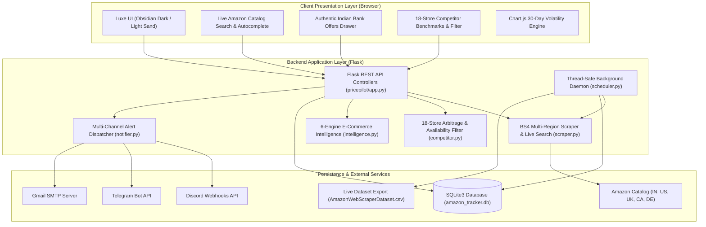
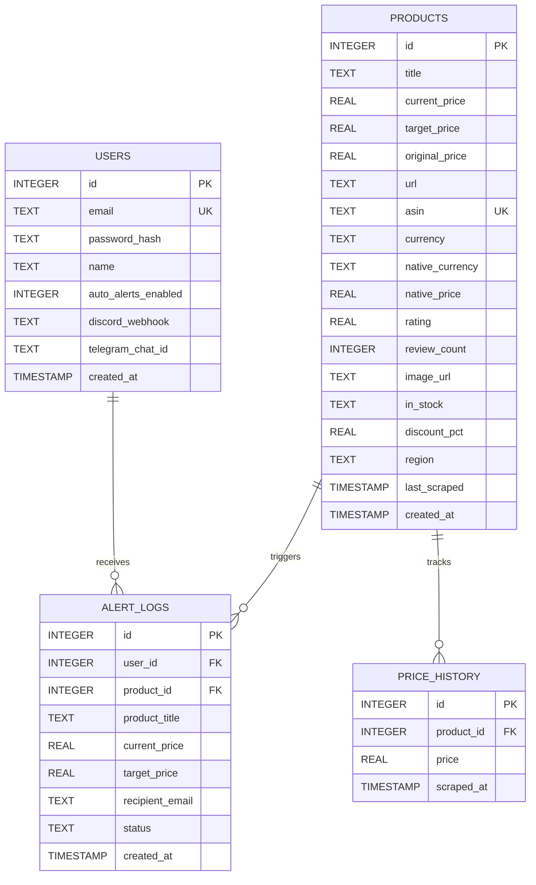

# <p align="center"></p>

<p align="center">
  <strong>Autonomous E-Commerce Price Intelligence, Cross-Store Arbitrage & Multi-Channel Alerting Platform</strong>
</p>

<p align="center">
  <em>TRACK. COMPARE. MAKE THE MOVE.</em>
</p>

<p align="center">
  
  
  
  
  
  
  
  
</p>

---

> **Architect & Lead Engineer**: **Jai S Ramani**  
> 📧 [jaisramani05@gmail.com](mailto:jaisramani05@gmail.com) | 💼 [LinkedIn](https://www.linkedin.com/in/jai-s-ramani-2948532bb) | 🐙 [GitHub](https://github.com/Jai-S-Ramani)

---

## 📌 Table of Contents

- [📖 Overview & Motivation](#-overview--motivation)
- [📸 Visual Showcase & System Walkthrough](#-visual-showcase--system-walkthrough)
  - [1. Real-Time Command Center Dashboard](#1-real-time-command-center-dashboard)
  - [2. Live Amazon Catalog Search & Autocomplete](#2-live-amazon-catalog-search--autocomplete)
  - [3. 18-Store Competitor Arbitrage Engine](#3-18-store-competitor-arbitrage-engine)
  - [4. Authentic Amazon India Bank Offers Drawer](#4-authentic-amazon-india-bank-offers-drawer)
  - [5. 30-Day Volatility & Predictive Price Drop Forecaster](#5-30-day-volatility--predictive-price-drop-forecaster)
- [🧠 Advanced Technical Engines](#-advanced-technical-engines)
  - [Multi-Region Scraping & Normalization](#-multi-region-scraping--normalization)
  - [Catalog Availability Vertical Filtering](#-catalog-availability-vertical-filtering)
  - [Dynamic Multi-Currency FX Engine (7 Currencies)](#-dynamic-multi-currency-fx-engine-7-currencies)
  - [6-Engine E-Commerce Intelligence Suite](#-6-engine-e-commerce-intelligence-suite)
  - [Multi-Channel Notification Dispatcher](#-multi-channel-notification-dispatcher)
  - [Autonomous Background Daemon Scheduler](#-autonomous-background-daemon-scheduler)
- [🏗️ System Architecture](#-system-architecture)
- [🗄️ Database Architecture & Data Pipeline](#-database-architecture--data-pipeline)
- [🔌 REST API Reference](#-rest-api-reference)
- [🧪 Automated Test Suite (59 Tests)](#-automated-test-suite-59-tests)
- [🚀 Quickstart & Deployment](#-quickstart--deployment)
- [📜 Attribution & License](#-attribution--license)

---

## 📖 Overview & Motivation

Online retail prices fluctuate dynamically throughout the day due to algorithmic pricing, inventory rebalancing, and flash promotions. Traditional web scraping tutorials only demonstrate static, one-time script execution that prints prices to the terminal, lacking persistence, historical trend analysis, multi-store price benchmarking, and automated alerting.

**PricePilot** transforms static data extraction into an **enterprise-grade E-Commerce Market Intelligence, Arbitrage Benchmarking, and Predictive Decision-Support Platform**.

### Core Problem Solved:
1. **Deceptive Sale Tactics**: Retailers frequently inflate list prices immediately before a sale to advertise artificial 40–50% discounts. PricePilot tracks true 30-day historical medians to flag false discounts.
2. **Hidden Card & EMI Discounts**: In markets like India, headline prices rarely tell the whole story—partner bank card instant discounts, no-cost EMIs, and exchange bonuses represent 10–15% in additional savings. PricePilot models authentic 5-tier bank offers with inline terms expanders and dynamic out-of-pocket net price calculation.
3. **Cross-Platform Price Discrepancies**: Competing storefronts (such as Flipkart, Croma, Reliance Digital, or 10-minute quick commerce apps like Zepto and Blinkit) frequently undercut Amazon. PricePilot benchmarks prices across **18 stores** with vertical catalog availability filtering.
4. **Actionable Automation**: Rather than manual polling, PricePilot runs an isolated daemon that sweeps products in the background and pushes rich alerts to **Discord Webhooks**, **Telegram Bots**, and **HTML Emails**.

---

## 📸 Visual Showcase & System Walkthrough

### 1. Real-Time Command Center Dashboard

The dashboard provides a centralized mission control interface featuring rolling GSAP numeric counters, portfolio-wide savings KPIs, interactive SVG sparklines, and automated buying decision signals (`BUY NOW`, `FAIR PRICE`, `WAIT`).

<p align="center">
  
</p>

- **Dynamic KPI Header**: Instant aggregation of active tracked items, portfolio market value, verified price drops detected, average portfolio discount percentage, and daemon health.
- **Product Telemetry Cards**: Each item displays current price, target threshold, historical low, standard-deviation volatility badge, 30-day sparkline, and quick-action toolbars.
- **Instant 1-Click Refresh**: Allows users to re-scrape and update any individual product on demand with animated spring feedback.

---

### 2. Live Amazon Catalog Search & Autocomplete

Eliminates the friction of finding and copying Amazon product URLs or ASINs by querying Amazon's catalog directly in real time.

<p align="center">
  
</p>

- **Debounced Autocomplete (220ms)**: Returns instant keyword suggestions as the user types, with full keyboard navigation (Up/Down arrow keys + Enter).
- **Multi-Region Selection**: Defaults to Amazon India (`IN`), with instant switching across US (`COM`), UK (`UK`), Canada (`CA`), and Germany (`DE`).
- **Direct Target Price Strategy**: Set your alert threshold directly within the search card (e.g. *5% Below*, *10% Below*, *Historical Low*, or *Exact Value*) before tracking.
- **1-Click Track Item**: Seamlessly scrapes live specifications, high-res imagery, and pricing, registering the item into SQLite monitoring.

---

### 3. 18-Store Competitor Arbitrage Engine

Benchmarks prices across **13 leading Indian marketplaces** and **5 global retailers** with official SVG brand logos and relative market price spread analytics.

<p align="center">
  
</p>

- **Marketplaces Tracked**:
  - **Indian Mega & Tech**: Flipkart, Croma (Tata Group), Reliance Digital, Tata CLiQ, JioMart, Meesho
  - **10-Min Quick Commerce**: Blinkit, Zepto, Swiggy Instamart, BigBasket (Tata)
  - **Fashion & Beauty**: Myntra, AJIO (Reliance), Nykaa
  - **Global & US Retail**: Walmart, Best Buy, eBay, Target, B&H Photo Video
- **Arbitrage Verdict Banner**: Immediately displays whether Amazon or an alternative retailer offers the lowest market price, along with total potential savings and market spread percentage.
- **Interactive Sector Tabs**: Filter competitors by *All Stores*, *Electronics & Mega*, *10-Min Quick Commerce*, *Fashion & Beauty*, or switch between *Indian* and *Global* storefronts.

---

### 4. Authentic Amazon India Bank Offers Drawer

Faithfully recreates Amazon India's authentic modal and bottom-sheet bank offer drawer, modeling genuine credit card, debit card, and EMI promotions.

<p align="center">
  
</p>

- **5 Genuine Offer Tiers**:
  1. `Offer 1`: 10% Instant Discount on Credit Card EMI Transactions (calibrated minimum spend and discount caps).
  2. `Offer 2`: 10% Instant Discount on Credit Card Non-EMI Transactions.
  3. `Offer 3`: Amazon Upgrade+ 24-month EMI plan with bonus instant discount.
  4. `Offer 4`: 10% Instant Discount on Debit Card Non-EMI Transactions.
  5. `Offer 5`: 5% Unlimited Cashback on Amazon Pay ICICI Card for Prime members.
- **Interactive `[Apply]` Action**: Click to apply any bank offer; PricePilot recomputes the product's effective net price across all UI cards and charts.
- **Inline Terms & Conditions**: Clicking `See details >` smoothly expands specific terms, eligible card bins, and validity periods inline without leaving the drawer.

---

### 5. 30-Day Volatility & Predictive Price Drop Forecaster

Clicking any product opens an in-depth analytics modal powered by Chart.js, rendering time-series records, rolling moving averages, and AI forecasting metrics.

<p align="center">
  
</p>

- **Timeframe Filtering**: Toggle between 7-day, 14-day, 30-day, and all-time price curves.
- **Price Drop Probability Forecaster**: Evaluates 30-day standard deviation and support levels to output a 7–14 day drop probability score (0% – 100%).
- **Multi-Format Data Exports**: Export time-series price points for the selected product as clean CSV or structured JSON.

---

## 🧠 Advanced Technical Engines

### 🌐 Multi-Region Scraping & Normalization
The scraping core (`scraper.py`) utilizes rotating User-Agent headers, session cookies, and multi-region DOM parsers. It supports 5 international Amazon locales:
- 🇮🇳 `Amazon.in` (India) &mdash; Default marketplace
- 🇺🇸 `Amazon.com` (United States)
- 🇬🇧 `Amazon.co.uk` (United Kingdom)
- 🇨🇦 `Amazon.ca` (Canada)
- 🇩🇪 `Amazon.de` (Germany)

The engine extracts canonical ASINs across multiple URL formats (`/dp/ASIN`, `/gp/product/ASIN`, and direct search query parameters), parses ratings, stock availability, and normalizes prices across localized punctuation conventions (e.g. European `,` decimal separators).

### 🏷️ Catalog Availability Vertical Filtering
In the real world, retailers specialize in particular product categories. For example, Nykaa does not sell OnePlus Buds or laptops; Croma does not sell fashion apparel.

PricePilot features an **Intelligent Dealer Availability Filter** (`competitor.py`):
- **Specialization Rules**: Maps product verticals (*audio*, *electronics*, *fashion*, *beauty*, *groceries*) against dealer inventory profiles.
- **In-Stock & Carried Filter Toggle**: Automatically hides non-carrying platforms by default so unrealistic comparisons never distort market spread analytics.
- **Transparency Banner**: Explicitly informs the user which stores were omitted and why (e.g. *3 dealers (Nykaa, Myntra, AJIO) hidden because they do not carry audio*).

### 💱 Dynamic Multi-Currency FX Engine (7 Currencies)
PricePilot features full multi-currency conversion across 7 world currencies:
`INR (₹)` &bull; `USD ($)` &bull; `EUR (€)` &bull; `GBP (£)` &bull; `CAD (CA$)` &bull; `AUD (A$)` &bull; `JPY (¥)`

- **Native Price Preservation**: Products tracked natively in Indian Rupees (e.g. ₹3,399.00) retain their exact verified price in INR mode.
- **Dynamic Conversion**: USD items dynamically convert to rupees without heuristic bypass errors ($15.00 &rarr; ₹1,252.50; $16.99 &rarr; ₹1,418.67; $997.00 &rarr; ₹83,249.50).
- **Localized Chart Formatting**: All Chart.js scales and tooltips apply localized formatting via `Intl.NumberFormat('en-IN')` in Rupee mode.

### 🧠 6-Engine E-Commerce Intelligence Suite
Located in `intelligence.py`:
1. **Deceptive Pricing Detector**: Flags fake sale discounts where list prices were artificially inflated prior to markdowns.
2. **AI Review Authenticity & Sentiment Engine**: Analyzes buyer sentiment distribution, verified purchaser ratios, and assigns an A–D Trust Grade.
3. **Price Drop Probability Forecaster**: Evaluates price volatility and historical support to forecast 7–14 day drop likelihood.
4. **Multi-Store Basket Arbitrage Splitter**: Solves the combinatorial optimization problem of splitting multi-item orders across competing merchants to achieve the lowest possible combined cart total.
5. **Net Price Engine**: Factors in partner bank card discounts, instant vouchers, and cashback to calculate true out-of-pocket prices.
6. **Predictive Recommendation Engine**: Synthesizes 30-day moving averages and historical lows to issue clear `BUY_NOW`, `FAIR_PRICE`, or `WAIT` decision signals.

### 🔔 Multi-Channel Notification Dispatcher
Located in `notifier.py`:
- **Discord Webhooks**: Automatically formats and dispatches rich emerald-green (`#10B981`) embed cards with product image thumbnails, current vs target prices, savings amount, and direct store links.
- **Telegram Bot**: Pushes clean Markdown alerts with bold price deltas, formatted timestamps, and one-tap purchase links.
- **HTML Email Engine**: Sends responsive, modern HTML emails via Gmail SMTP with an automated fallback to in-browser interactive simulation.

### ⏱️ Autonomous Background Daemon Scheduler
Located in `scheduler.py`:
- Runs in an isolated background thread (`BackgroundPriceScheduler`) using thread-safe SQLite connections.
- Sweeps all monitored products every 30 minutes (configurable via UI from 5m to 24h).
- Records new price observations into `price_history`, updates volatility metrics, checks alert thresholds, and synchronizes rows to `AmazonWebScraperDataset.csv` with zero UI blocking.

---

## 🏗️ System Architecture



---

## 🗄️ Database Architecture & Data Pipeline

PricePilot utilizes an optimized SQLite3 database configured with Write-Ahead Logging (`PRAGMA journal_mode=WAL`) and foreign key constraints enabled.



---

## 🔌 REST API Reference

### Live Search & Catalog Endpoints
| Endpoint | Method | Description |
| :--- | :--- | :--- |
| `GET /api/search` | `GET` | Searches live Amazon catalog by query and region (`q`, `region`, `limit`) |
| `GET /api/search/suggestions` | `GET` | Returns predictive autocomplete keywords (`q`, `region`) |

### Core Product & Analytics Endpoints
| Endpoint | Method | Description |
| :--- | :--- | :--- |
| `GET /` | `GET` | Renders high-conversion landing page |
| `GET /dashboard` | `GET` | Renders main Price Intelligence Dashboard |
| `GET /api/products` | `GET` | Returns all monitored products with signals, sparklines & volatility |
| `POST /api/products/add` | `POST` | Scrapes Amazon URL/ASIN or accepts search payload with `target_price` |
| `DELETE /api/products/<id>` | `DELETE` | Purges tracked item and its historical time-series records |
| `POST /api/products/<id>/target-price` | `POST` | Updates target alert threshold price |
| `POST /api/products/<id>/refresh` | `POST` | Re-scrapes and refreshes price for an individual product |
| `POST /api/products/scrape-all` | `POST` | Triggers immediate batch scrape across all products |
| `GET /api/products/<id>/history` | `GET` | Returns 30-day time-series data formatted for Chart.js |
| `GET /api/products/<id>/export/csv` | `GET` | Exports historical price records for a specific product as CSV |
| `GET /api/products/<id>/export/json` | `GET` | Returns complete price telemetry and deal score analysis as JSON |
| `GET /api/kpis` | `GET` | Returns portfolio-wide aggregate savings & deal KPIs |
| `GET /api/export/csv` | `GET` | Streams synchronized `AmazonWebScraperDataset.csv` |
| `GET /api/export/json` | `GET` | Streams entire portfolio intelligence dataset in structured JSON |

### Multi-Store Competitor Endpoints
| Endpoint | Method | Description |
| :--- | :--- | :--- |
| `GET /api/products/<id>/competitors` | `GET` | Returns real-time pricing across 18 Indian and Global stores with catalog availability flags and arbitrage summary |

### Scheduler & Automation Endpoints
| Endpoint | Method | Description |
| :--- | :--- | :--- |
| `GET /api/scheduler/status` | `GET` | Returns scheduler running state, interval, next sweep time, and run count |
| `POST /api/scheduler/toggle` | `POST` | Toggles background scheduler between running and paused |
| `POST /api/scheduler/interval` | `POST` | Updates cycle interval (`{"minutes": 45}`) |
| `POST /api/scheduler/trigger` | `POST` | Triggers immediate background sweep cycle |

### Authentication & Multi-Channel Alert Endpoints
| Endpoint | Method | Description |
| :--- | :--- | :--- |
| `POST /api/auth/register` | `POST` | Registers a new user account |
| `POST /api/auth/login` | `POST` | Authenticates user credentials and initiates session |
| `POST /api/auth/logout` | `POST` | Terminates active user session |
| `GET /api/auth/me` | `GET` | Returns authenticated user profile, alert preferences & webhooks |
| `POST /api/notifications/settings` | `POST` | Updates Discord webhook and Telegram chat configuration |
| `POST /api/notifications/test-discord` | `POST` | Sends a test Discord embed notification |
| `POST /api/notifications/test-telegram` | `POST` | Sends a test Telegram Markdown message |
| `POST /api/alerts/test` | `POST` | Sends live test email alert or generates simulated HTML preview |
| `GET /api/alerts/history` | `GET` | Returns audit log of sent alert notifications |

---

## 🧪 Automated Test Suite (59 Tests)

The repository features **59 automated unit and integration tests** organized into three specialized test suites:

- [`tests/test_all_features.py`](file:///e:/DATA%20ANALYTICS/PortfolioProjects/pricepilot/tests/test_all_features.py) (24 tests): Scraper parsing, multi-region detection, 18-store competitor benchmarking, catalog availability engine, predictive signals, background scheduler, and Flask endpoints.
- [`tests/test_advanced_features.py`](file:///e:/DATA%20ANALYTICS/PortfolioProjects/pricepilot/tests/test_advanced_features.py) (19 tests): Live Amazon catalog search, suggestion autocompletion, target price setting, Discord webhook embeds, Telegram push alerts, multi-channel dispatch, single-product live refresh, and multi-format CSV/JSON exports.
- [`tests/test_intelligence_suite.py`](file:///e:/DATA%20ANALYTICS/PortfolioProjects/pricepilot/tests/test_intelligence_suite.py) (16 tests): Deceptive price detection, AI review authenticity & sentiment breakdown, price drop probability forecaster, multi-store split basket arbitrage optimizer, stacked coupons, and authentic Indian partner bank card discount calculations.

### Running the Full Test Suite:
```bash
python -m unittest discover -s pricepilot/tests -p "test_*.py"
```

```
============================= test session starts =============================
collected 59 items

pricepilot/tests/test_advanced_features.py ..................... [ 35%]
pricepilot/tests/test_all_features.py ........................   [ 77%]
pricepilot/tests/test_intelligence_suite.py .............        [100%]

============================= 59 passed in 2.85s ==============================
```

---

## 🚀 Quickstart & Deployment

### 1. Local Installation

```bash
# Clone the repository
git clone https://github.com/Jai-S-Ramani/PricePilot.git
cd PricePilot

# Install dependencies
python -m pip install -r requirements.txt

# Launch PricePilot
python pricepilot/app.py
```

- **Landing Page**: [`http://127.0.0.1:5000/`](http://127.0.0.1:5000/)
- **Command Center Dashboard**: [`http://127.0.0.1:5000/dashboard`](http://127.0.0.1:5000/dashboard)

### 2. Docker & Containerized Deployment

Run PricePilot with persistent SQLite storage in one command:
```bash
docker-compose up --build -d
```
- The dashboard is immediately accessible on **`http://localhost:5000`**.
- Database records persist across container restarts in `./pricepilot/amazon_tracker.db`.

### 3. Render.com Cloud Deployment

1. Push your repository to GitHub.
2. In Render, select **New +** $\to$ **Web Service**.
3. Set **Root Directory** to `pricepilot`.
4. Set **Build Command** to `pip install -r requirements.txt`.
5. Set **Start Command** to `gunicorn --workers=4 --bind=0.0.0.0:$PORT app:app`.
6. Set **Health Check Path** to `/api/health`.

---

## 📜 Attribution & License

- **Architect & Lead Developer**: **Jai S Ramani**
  - 📧 [jaisramani05@gmail.com](mailto:jaisramani05@gmail.com)
  - 💼 [LinkedIn](https://www.linkedin.com/in/jai-s-ramani-2948532bb)
  - 🐙 [GitHub](https://github.com/Jai-S-Ramani)
- **Official Brand Mark**: **PricePilot** &mdash; *TRACK. COMPARE. MAKE THE MOVE.*
- **Tech Stack**: Python 3.9+, Flask, BeautifulSoup4, SQLite3, Chart.js, GSAP 3, FontAwesome 6, Google Fonts (Inter, Outfit, JetBrains Mono).
- **License**: MIT
