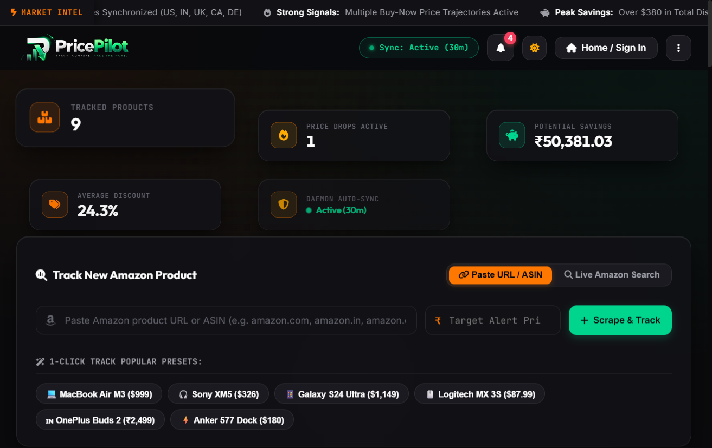
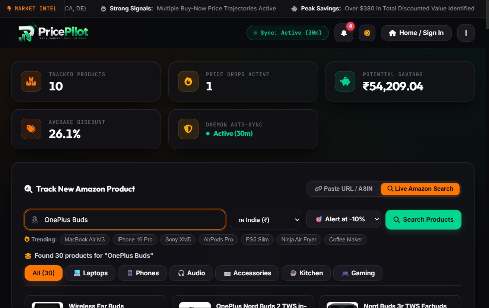
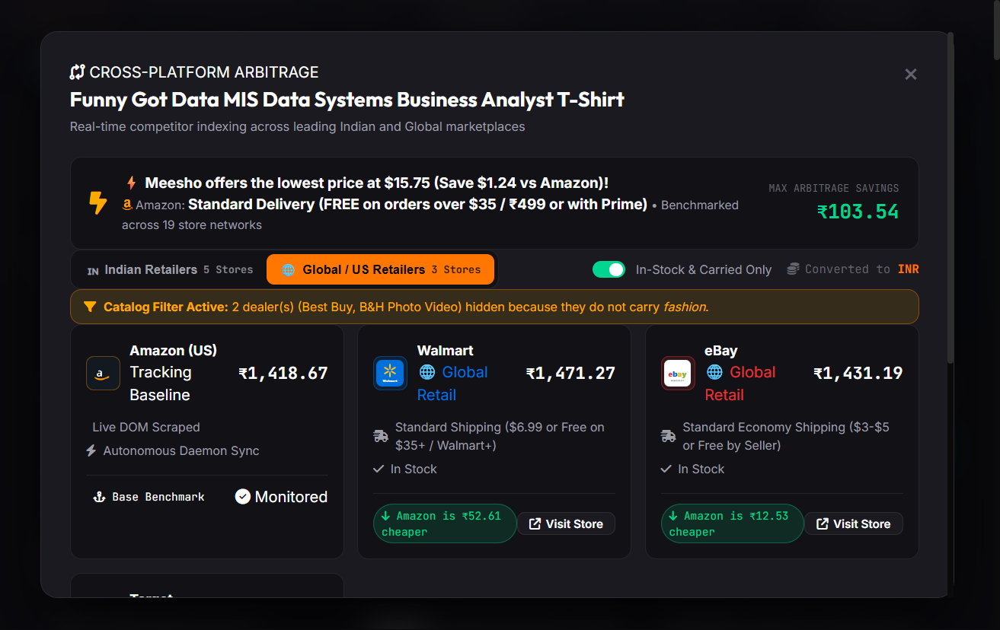
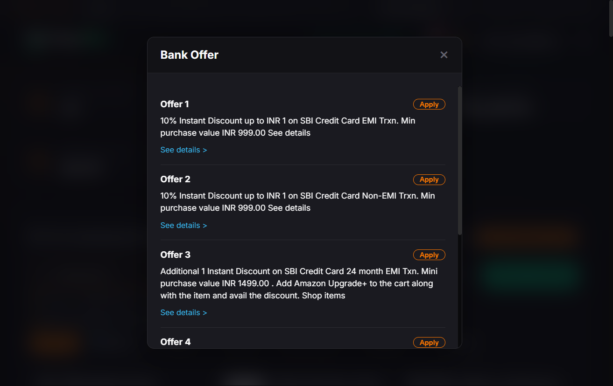
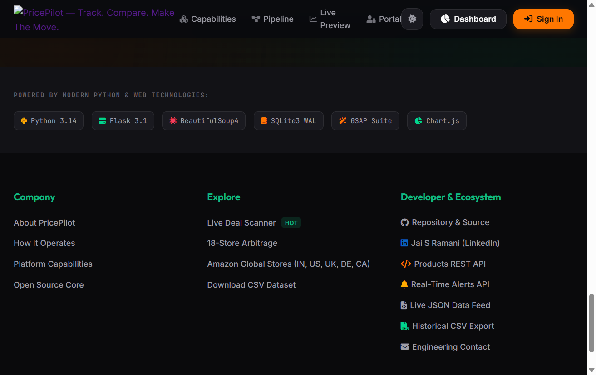

# <p align="center"></p>

<p align="center">
  <strong>Autonomous E-Commerce Price Intelligence, Cross-Store Arbitrage & Multi-Channel Alerting Platform</strong>
</p>

<p align="center">
  <em>TRACK. COMPARE. MAKE THE MOVE.</em>
</p>

<p align="center">
  
  
  
  
  
  
</p>

---

> **Architect & Lead Engineer**: **Jai S Ramani**  
> 📧 **Email**: [jaisramani05@gmail.com](mailto:jaisramani05@gmail.com) | 💼 **LinkedIn**: [jai-s-ramani-2948532bb](https://www.linkedin.com/in/jai-s-ramani-2948532bb) | 🐙 **GitHub**: [Jai-S-Ramani](https://github.com/Jai-S-Ramani)

---

## 📌 Table of Contents

- [Overview](#-overview)
- [Official Brand Identity](#-official-brand-identity)
- [Key Features](#-key-features)
  - [1. Real-Time Amazon Catalog Search & Predictive Autocomplete with Target Price Setting](#1-real-time-amazon-catalog-search--predictive-autocomplete-with-target-price-setting)
  - [2. Multi-Store Competitor Arbitrage Engine (18 Stores with Official Logos)](#2-multi-store-competitor-arbitrage-engine-18-stores-with-official-logos)
  - [3. Authentic Amazon India Bank Offers Drawer & Instant Discounts](#3-authentic-amazon-india-bank-offers-drawer--instant-discounts)
  - [4. Advanced E-Commerce Intelligence Suite](#4-advanced-e-commerce-intelligence-suite)
  - [5. Intelligent Dealer Catalog Availability Filter](#5-intelligent-dealer-catalog-availability-filter)
  - [7. Multi-Channel Alert Dispatcher (Email, Discord & Telegram)](#7-multi-channel-alert-dispatcher-email-discord--telegram)
  - [8. Autonomous Background Price Scheduler Daemon](#8-autonomous-background-price-scheduler-daemon)
  - [9. Multi-Currency FX Engine & Exact Price Normalization (7 Currencies)](#9-multi-currency-fx-engine--exact-price-normalization-7-currencies)
  - [10. Predictive Analytics & Volatility Scoring](#10-predictive-analytics--volatility-scoring)
  - [11. Interactive 30-Day Time-Series & Inline Sparklines](#11-interactive-30-day-time-series--inline-sparklines)
- [Design System & Theme Switcher](#-design-system--theme-switcher)
- [Project Architecture](#-project-architecture)
- [Database Schema & Data Pipeline](#-database-schema--data-pipeline)
- [REST API Reference](#-rest-api-reference)
- [Automated Test Suite (59 Tests)](#-automated-test-suite-59-tests)
- [Installation & Quickstart](#-installation--quickstart)
- [Multi-Channel Notification Setup](#-multi-channel-notification-setup)
- [Attribution & Credits](#-attribution--credits)

---

## 📖 Overview

**PricePilot** transforms static web scraping scripts into an autonomous monitoring, competitor arbitrage, live catalog search, and decision-support command center. It tracks products across 5 international Amazon regions (defaulting to Amazon India `IN`), benchmarks real-time prices across **18 leading Indian and Global retailer marketplaces**, filters out non-carrying dealers dynamically, computes historical price volatility, dispatches alerts across Email, Discord, and Telegram, and automatically executes price drop tracking.

### Core Highlights:
1. **Live Amazon Catalog Search & Suggestions**: Real-time Amazon product search with predictive autocomplete suggestions, regional marketplace selection (🇮🇳 India by default), direct target alert price configuration, and 1-click tracking directly from search cards.
2. **Multi-Retailer Competitor Comparison**: Benchmarks Amazon against 13 leading Indian marketplaces (Flipkart, Croma, Reliance Digital, Tata CLiQ, JioMart, Meesho, Blinkit, Zepto, Swiggy Instamart, BigBasket, Myntra, AJIO, Nykaa) and 5 global retailers (Walmart, Best Buy, eBay, Target, B&H Photo) with official vector branding.
3. **Catalog Availability Engine**: Dynamically identifies whether a dealer actually stocks a given product vertical (e.g., Nykaa does not sell OnePlus Buds; Croma does not sell fashion dresses) with an interactive UI toggle.
4. **Multi-Channel Alerts**: Automated notification engine dispatching rich HTML emails, Discord webhook embeds, and Telegram bot messages when target prices are reached.
5. **Multi-Currency System (7 Currencies)**: Full support for INR (`₹`), USD (`$`), EUR (`€`), GBP (`£`), CAD (`CA$`), AUD (`A$`), and JPY (`¥`), preserving exact native prices (`₹83,416.50`) and preventing multi-currency conversion discrepancies.
6. **Autonomous Daemon Scheduler**: Thread-safe background worker sweeps monitored products, calculates volatility, logs time-series records to SQLite, and maintains an exportable dataset (`AmazonWebScraperDataset.csv`).
7. **Predictive Recommendation Engine**: Analyzes 30-day moving averages and historical lows to output real-time `BUY_NOW`, `FAIR_PRICE`, or `WAIT` decision signals.
8. **Minimalist Dual-Theme UI**: Obsidian Dark & Light Sand themes with 1-click instant toggle on both the landing page and dashboard.

---

## 💎 Official Brand Identity

**PricePilot** is defined by a bold, high-tech visual identity:

- **The 3D Emblem**: A precision obsidian capital **'P'** unified with a dual-bar volume chart and sliced diagonally by a faceted, luminous emerald-green price drop arrow.
- **Wordmark & Typography**: **Price<span style="color:#10b981">Pilot</span>** featuring obsidian/white primary typography and a radiant emerald gradient (`#10b981` &rarr; `#00e676`).
- **Tagline**: `TRACK. COMPARE. MAKE THE MOVE.`
- **Theme-Adaptive Delivery**:
  - `static/images/pricepilot_brand_dark.png`: Custom dark mode logo with metallic chrome specular reflections, glowing emerald aura, and translucent luminance alpha blending.
  - `static/images/pricepilot_brand_light.png`: Optimized for light themes with obsidian "Price" and vibrant emerald "Pilot".
  - `static/images/pricepilot_exact_square.png`: 1024×1024 master square dark-mode brand asset.
  - `static/images/logo.png`: 1024×1024 high-resolution master asset & favicon.
  - `static/images/logo.svg`: Scalable vector asset.

---

## 📸 Visual Showcase

| Command Center Dashboard | Live Amazon Catalog Search |
| :---: | :---: |
|  |  |

| 18-Store Competitor Arbitrage | Authentic Bank Offers Drawer |
| :---: | :---: |
|  |  |

| 30-Day Volatility & Forecast | High-Conversion Landing Page |
| :---: | :---: |
|  |  |

---

## ✨ Key Features

### 1. Real-Time Amazon Catalog Search & Predictive Autocomplete with Target Price Setting
- **Live Search Modal**: Search Amazon's live catalog directly without manually finding product URLs or ASINs.
- **Direct Target Alert Price Input**: Set your desired alert price directly within the live search interface before tracking, instantly establishing your threshold.
- **Predictive Autocomplete**: Instant search suggestions as you type with debounced querying (220ms), keyboard navigation (Up/Down arrows + Enter), and outside-click dismiss.
- **Indian Marketplace Default**: Configured to default to Amazon India (`IN`) and Indian Rupee (`₹` / `INR`) with quick regional switching (US, UK, CA, DE).
- **1-Click Track Item**: Search result cards include verified imagery, ratings, pricing, and a 1-click `+ Track Item` button that seamlessly registers the product into SQLite monitoring.

### 2. Multi-Store Competitor Arbitrage Engine (18 Stores with Official Logos)
- **18 Marketplaces Benchmarked with Official Brand Logos**:
  - **Indian Mega & Tech**: Flipkart, Croma (Tata Group), Reliance Digital, Tata CLiQ, JioMart, Meesho
  - **10-Min Quick Commerce**: Blinkit, Zepto, Swiggy Instamart, BigBasket (Tata)
  - **Fashion & Beauty**: Myntra, AJIO (Reliance), Nykaa
  - **Global & US Retail**: Walmart, Best Buy, eBay, Target, B&H Photo Video
- **Arbitrage Verdict Banner**: Instantly highlights whether Amazon or a competitor holds the lowest market price, along with maximum savings and total market price spread.
- **Interactive Sector Tabs & Channel Pills**: Switch between Indian and Global retail tabs or filter by channels (*All Stores*, *Fashion & Beauty*, *10-Min Quick Commerce*, *Electronics & Mega*).
- **Market Price Spread Visualizer**: Relative percentage bars display price distribution across all carrying stores with a Best Price trophy badge.

### 3. Authentic Amazon India Bank Offers Drawer & Instant Discounts
- **Exact Amazon India Drawer Layout**: Recreated the authentic modal/bottom-sheet layout with:
  - **Offer 1**: `10% Instant Discount up to INR [cap] on [Bank] Credit Card EMI Trxn. Min purchase value INR [min].00`
  - **Offer 2**: `10% Instant Discount up to INR [cap] on [Bank] Credit Card Non-EMI Trxn. Min purchase value INR [min].00`
  - **Offer 3**: `Additional [cap] Instant Discount on [Bank] Credit Card 24 month EMI Txn. Mini purchase value INR [min].00 . Add Amazon Upgrade+ to the cart along with the [item] and avail the discount. Shop items`
  - **Offer 4**: `10% Instant Discount up to INR [cap] on [Bank] Debit Card Non-EMI Trxn. Min purchase value INR [min].00`
  - **Offer 5**: `5% Unlimited Cashback on Amazon Pay ICICI Card for Prime members. No minimum spend value.`
- **Calibrated Dynamically for Each Product**: Automatically adapts to product vertical (*phones*, *headphones*, *laptops*, *accessories*) and adjusts minimum spend thresholds based on product price tiers.
- **Interactive `[Apply]` Action**: Allows instant card selection directly within the drawer, calculating the effective net price with immediate visual feedback and toast notifications.
- **Inline Terms & Conditions**: Clicking `See details >` smoothly expands specific bank terms and conditions inline.
- **How to Avail Offer Section**: Displays the exact checkout instructions (*Select eligible card at checkout; No promo code required*).

### 4. Advanced E-Commerce Intelligence Suite
- **Deceptive Pricing Detection**: Flags artificial markups where retailers inflate list prices right before a "sale" discount.
- **AI Review Authenticity & Sentiment Grading**: Computes an A–D Trust Grade, sentiment breakdown (positive, neutral, critical), verified purchaser percentage, and AI consensus highlights.
- **Price Drop Probability Forecaster**: Evaluates 30-day volatility and historical support levels to project 7–14 day price drop probability scores (0% – 100%).
- **Multi-Store Basket Arbitrage Splitter**: Optimizes multi-item cart purchases across competing stores to find the lowest possible split-order total.
- **Net Price Engine**: Computes true out-of-pocket price factoring in partner bank card instant discounts.

### 5. Intelligent Dealer Catalog Availability Filter
- **Real-World Category Mapping**:
  - **Quick Commerce (Zepto, Blinkit, Instamart, BigBasket)**: Actively stocks audio earbuds (OnePlus Buds, boAt), tech accessories, phone chargers, daily grooming, and groceries.
  - **Electronics Specialists (Croma, Reliance Digital, Best Buy, B&H Photo)**: Dedicated to audio, tech, laptops, phones, and appliances.
  - **Pure Fashion Specialists (Myntra, AJIO)**: Strictly apparel and footwear; completely excludes audio/electronics.
  - **Pure Cosmetics & Beauty Specialist (Nykaa)**: Strictly cosmetics and skincare; completely excludes tech/earbuds.
- **Interactive "In-Stock & Carried Only" Toggle**:
  - **Enabled by Default**: Automatically hides platforms that do not sell the product category (e.g., viewing OnePlus Buds hides Nykaa, Myntra, and AJIO).
  - **Catalog Filter Notice Banner**: Explains which dealers were excluded and why (e.g., *Catalog Filter Active: 3 dealer(s) (Nykaa, Myntra, AJIO) hidden because they do not carry audio*).
  - **Uncarried Muted State**: Toggling the filter off renders excluded stores with dashed borders, low opacity, a red `⊘ Not Sold Here` badge, and disabled CTAs.
- **Protected Spread Analytics**: Non-carrying stores are strictly excluded from winner calculations and spread metrics so unavailable dealers never distort market pricing.

### 7. Multi-Channel Alert Dispatcher (Email, Discord & Telegram)
- **Discord Rich Embeds**: Automatically pushes emerald green `#10B981` embed cards to your Discord channel featuring product thumbnails, price drops, target comparisons, and direct store links.
- **Telegram Push Alerts**: Delivers real-time Markdown-formatted push notifications via Telegram Bot API with instant buy actions.
- **HTML Email Engine**: Dispatches responsive HTML alert emails or renders them in the built-in in-browser preview simulator.
- **Multi-Channel Dispatcher (`dispatch_multi_channel_alert`)**: Automatically triggers across all enabled channels when automated sweeps detect a price below target.
- **User Settings Modal**: Configure custom Discord Webhook URLs and Telegram Chat IDs directly from the dashboard 3-dot menu with live test buttons.

### 8. Autonomous Background Price Scheduler Daemon
- **Thread-Safe Daemon (`scheduler.py`)**: Continuously monitors tracked products in an isolated worker thread.
- **Configurable Cadence**: Adjust sweep intervals on the fly (15m, 30m, 45m, 60m) via REST API or the header dropdown.
- **Live Status Header Pill**: Real-time pulsing radar indicator (`Sync: Active (30m)`) with pause, resume, and immediate manual sweep capabilities.

### 9. Multi-Currency FX Engine & Exact Price Normalization (7 Currencies)
- **7 Currencies Supported**: `INR (₹)`, `USD ($)`, `EUR (€)`, `GBP (£)`, `CAD (CA$)`, `AUD (A$)`, and `JPY (¥)`.
- **Exact Native Price Preservation**: Scraped prices are stored with both normalized base USD and exact native currency figures (`native_price`, `currency`, `symbol`).
- **Indian Numbering Format (`en-IN`)**: When viewing in INR, prices are formatted to Indian standards (e.g., `₹1,88,735.00` or `₹2,999.00`), ensuring 100% 1:1 price consistency between search cards and monitored dashboard cards.

### 10. Predictive Analytics & Volatility Scoring
- **Actionable Decision Signals**:
  - 🟢 **Buy Now (Strong Deal)**: Current price is $\le$ target price or within 3% of the 30-day historical low.
  - 🟡 **Fair Price**: Current price is below the 30-day moving average.
  - 🔴 **Wait for Drop**: Price is elevated above the 30-day moving average.
- **Standard Deviation Volatility**: Quantifies price fluctuations into `Stable`, `Moderate`, or `High` risk tiers.
- **Portfolio KPIs**: Real-time roll-up metrics tracking Total Products, Active Deals, Total Savings ($), and Average Discount %.

### 11. Interactive 30-Day Time-Series & Inline Sparklines
- **Inline SVG Sparklines**: Every product card displays a dedicated 30-day mini-trajectory chart with gradient fills and percentage delta tags (`🟢 -X.X% 30d` or `🔴 +X.X% 30d`).
- **Modal Deep-Dive Chart (Chart.js)**: Detailed time-series plot comparing 30-day prices against 30-Day Low, 30-Day High, Moving Average, and Alert Target Price lines.

---

## 🎨 Design System & Theme Switcher

The interface is engineered with Vanilla CSS adhering to a modern dual-theme architecture:

| Token | 🌙 Obsidian Dark (Default) | ☀️ Light Sand Luxe | Usage |
| :--- | :--- | :--- | :--- |
| **Deep Background** | `#090d16` &rarr; `#0f172a` | `#f8fafc` &rarr; `#ffffff` | Canvas background |
| **Primary Accent** | Emerald Neon (`#10b981` / `#00e676`) | Forest Emerald (`#059669`) | Brand highlights, price drop signals, active tabs |
| **Flame Amber** | Amber Gold (`#f59e0b` / `#fbbf24`) | Amber Bronze (`#d97706`) | Target alerts, deals, quick add buttons |
| **Surface Cards** | `#131b2e` (24px backdrop blur) | `#ffffff` (elevated shadow) | Product cards, modals, table headers |
| **Borders** | `rgba(255, 255, 255, 0.08)` | `rgba(0, 0, 0, 0.08)` | Subdued container dividers |

### Theme Toggle:
A dedicated 1-click **Light / Dark Mode** button is positioned right in the top navigation bar across both the Landing Page (`#landingThemeToggleBtn`) and Dashboard (`#themeToggleBtn`), synchronizing seamlessly across views and preserving user preferences in `localStorage`.

---

## 📁 Project Architecture

```
PortfolioProjects/
├── AmazonWebScraperDataset.csv       # Live synchronized CSV export
├── run_original_scraper.py          # Standalone runner for single-item command-line scraper
├── architecture.html                # Interactive system architecture diagram
├── pricepilot.architecture.json     # Architecture specification model
└── pricepilot/
    ├── app.py                       # Flask application, routing & REST API controllers
    ├── scheduler.py                 # Thread-safe BackgroundPriceScheduler daemon
    ├── scraper.py                   # Multi-region BS4 scraper, live search & suggestion engine
    ├── competitor.py                # 18-store competitor comparison & catalog availability engine
    ├── intelligence.py              # 6-engine e-commerce intelligence & Indian bank offers engine
    ├── database.py                  # SQLite database manager, analytics & seed pipelines
    ├── notifier.py                  # Email, Discord webhook & Telegram notification engine
    ├── amazon_tracker.db            # Production SQLite3 database
    ├── README.md                    # Detailed application documentation
    ├── tests/
    │   ├── test_all_features.py     # Base test suite (24 passing unit & integration tests)
    │   ├── test_advanced_features.py# Search & notification tests (19 passing tests)
    │   └── test_intelligence_suite.py # 6-engine intelligence suite tests (16 passing tests)
    ├── static/
    │   ├── css/
    │   │   ├── styles.css           # Dashboard design system & theme variables
    │   │   └── landing.css          # Landing page styles & animation rules
    │   ├── js/
    │   │   ├── app.js               # Client controller, search autocomplete, GSAP & Chart.js
    │   │   └── landing.js           # Landing page animations, fast demo login & theme toggle
    │   └── images/
    │       ├── logo.png             # Official PricePilot 1024x1024 master emblem
    │       ├── pricepilot_brand_dark.png  # Transparent dark-mode brand lockup
    │       ├── pricepilot_brand_light.png # Transparent light-mode brand lockup
    │       ├── logo.svg             # Scalable vector emblem
    │       ├── product-placeholder.svg    # Self-hosted product placeholder fallback
    │       ├── products/            # 14 verified high-res local product photography assets
    │       └── retailers/           # 18 official SVG brand logos for competitor stores
    └── templates/
        ├── index.html               # Main dashboard with live search & competitor modals
        └── landing.html             # High-conversion landing page & authentication portal
```

---

## 💾 Database Schema & Data Pipeline

### SQLite Schema (`amazon_tracker.db`)

#### 1. `products` Table
| Column | Type | Description |
| :--- | :--- | :--- |
| `id` | `INTEGER PRIMARY KEY` | Auto-increment identifier |
| `asin` | `TEXT UNIQUE` | Amazon Standard Identification Number |
| `title` | `TEXT` | Clean product title |
| `current_price` | `REAL` | Current price (normalized base USD) |
| `original_price`| `REAL` | List/MSRP price |
| `target_price` | `REAL` | User alert threshold (base USD) |
| `native_price` | `REAL` | Scraped price in original marketplace currency |
| `currency` | `TEXT` | Native currency ISO code (`INR`, `USD`, `GBP`, etc.) |
| `symbol` | `TEXT` | Native currency symbol (`₹`, `$`, `£`, etc.) |
| `region` | `TEXT` | Amazon regional marketplace (`IN`, `US`, `UK`, `CA`, `DE`) |
| `url` | `TEXT` | Direct Amazon product URL |
| `image_url` | `TEXT` | Verified product photography URL |
| `rating` | `REAL` | Star rating (1.0 – 5.0) |
| `reviews_count` | `INTEGER` | Total customer review count |
| `availability` | `TEXT` | In-stock status string |
| `category` | `TEXT` | Product retail category |
| `last_scraped` | `TIMESTAMP` | Timestamp of most recent sweep |

#### 2. `price_history` Table
| Column | Type | Description |
| :--- | :--- | :--- |
| `id` | `INTEGER PRIMARY KEY` | Auto-increment identifier |
| `product_id` | `INTEGER` | Foreign Key referencing `products(id)` |
| `price` | `REAL` | Historical price point |
| `timestamp` | `TIMESTAMP` | Exact check timestamp (`YYYY-MM-DD HH:MM:SS`) |
| `date` | `TEXT` | Log date (`YYYY-MM-DD`) |

#### 3. `users` Table
| Column | Type | Description |
| :--- | :--- | :--- |
| `id` | `INTEGER PRIMARY KEY` | Auto-increment identifier |
| `email` | `TEXT UNIQUE` | User email address |
| `password_hash` | `TEXT` | Salted SHA-256 password hash |
| `name` | `TEXT` | User display name |
| `auto_alerts_enabled` | `INTEGER` | Automatic alert dispatch toggle |
| `discord_webhook` | `TEXT` | User Discord Webhook URL |
| `telegram_chat_id` | `TEXT` | User Telegram Chat ID |
| `created_at` | `TIMESTAMP` | Account creation timestamp |

#### 4. `alert_logs` Table
| Column | Type | Description |
| :--- | :--- | :--- |
| `id` | `INTEGER PRIMARY KEY` | Auto-increment identifier |
| `user_id` | `INTEGER` | Foreign Key referencing `users(id)` |
| `product_id` | `INTEGER` | Foreign Key referencing `products(id)` |
| `product_title` | `TEXT` | Product title snapshot |
| `current_price` | `REAL` | Trigger price |
| `target_price` | `REAL` | Target threshold |
| `recipient_email` | `TEXT` | Target destination inbox / channel |
| `status` | `TEXT` | Delivery status (`SENT`, `SIMULATED`) |
| `created_at` | `TIMESTAMP` | Notification dispatch timestamp |

---

## 🔌 REST API Reference

### Live Search & Catalog Endpoints
| Endpoint | Method | Description |
| :--- | :--- | :--- |
| `GET /api/search` | `GET` | Searches live Amazon catalog by query and region (`q`, `region`, `limit`) |
| `GET /api/search/suggestions` | `GET` | Returns predictive autocomplete keywords (`q`, `region`) |

### Core Product & Analytics Endpoints
| Endpoint | Method | Description |
| :--- | :--- | :--- |
| `GET /` | `GET` | Renders high-conversion landing page |
| `GET /dashboard` | `GET` | Renders main Price Intelligence Dashboard |
| `GET /api/products` | `GET` | Returns all monitored products with signals, sparklines & volatility |
| `POST /api/products/add` | `POST` | Scrapes Amazon URL/ASIN or accepts search payload with `target_price` |
| `DELETE /api/products/<id>` | `DELETE` | Purges tracked item and its historical time-series data |
| `POST /api/products/<id>/target-price` | `POST` | Updates target alert threshold price |
| `POST /api/products/<id>/refresh` | `POST` | Re-scrapes and refreshes price for an individual product |
| `POST /api/products/scrape-all` | `POST` | Triggers immediate batch scrape across all products |
| `GET /api/products/<id>/history` | `GET` | Returns 30-day time-series data formatted for Chart.js |
| `GET /api/products/<id>/export/csv` | `GET` | Exports historical price records for a specific product as CSV |
| `GET /api/products/<id>/export/json` | `GET` | Returns complete price telemetry and deal score analysis as JSON |
| `GET /api/kpis` | `GET` | Returns portfolio-wide aggregate savings & deal KPIs |
| `GET /api/export/csv` | `GET` | Streams synchronized `AmazonWebScraperDataset.csv` |
| `GET /api/export/json` | `GET` | Streams entire portfolio intelligence dataset in structured JSON |

### Multi-Store Competitor Endpoints
| Endpoint | Method | Description |
| :--- | :--- | :--- |
| `GET /api/products/<id>/competitors` | `GET` | Returns real-time pricing across 18 Indian and Global stores with catalog availability flags and arbitrage summary |

### Scheduler & Automation Endpoints
| Endpoint | Method | Description |
| :--- | :--- | :--- |
| `GET /api/scheduler/status` | `GET` | Returns scheduler running state, interval, next sweep time, and run count |
| `POST /api/scheduler/toggle` | `POST` | Toggles background scheduler between running and paused |
| `POST /api/scheduler/interval` | `POST` | Updates cycle interval (`{"minutes": 45}`) |
| `POST /api/scheduler/trigger` | `POST` | Triggers immediate background sweep cycle |

### Authentication & Multi-Channel Alert Endpoints
| Endpoint | Method | Description |
| :--- | :--- | :--- |
| `POST /api/auth/register` | `POST` | Registers a new user account |
| `POST /api/auth/login` | `POST` | Authenticates user credentials and initiates session |
| `POST /api/auth/logout` | `POST` | Terminates active user session |
| `GET /api/auth/me` | `GET` | Returns authenticated user profile, alert preferences & webhooks |
| `POST /api/notifications/settings` | `POST` | Updates Discord webhook and Telegram chat configuration |
| `POST /api/notifications/test-discord` | `POST` | Sends a test Discord embed notification |
| `POST /api/notifications/test-telegram` | `POST` | Sends a test Telegram Markdown message |
| `POST /api/alerts/test` | `POST` | Sends live test email alert or generates simulated HTML preview |
| `GET /api/alerts/history` | `GET` | Returns audit log of sent alert notifications |

---

## 🧪 Automated Test Suite (59 Tests)

The repository features **59 automated unit and integration tests** organized into three specialized test suites:
- [`tests/test_all_features.py`](tests/test_all_features.py) (24 tests): Scraper parsing, 18-store competitor benchmarking, catalog availability engine, predictive signals, background scheduler, and Flask endpoints.
- [`tests/test_advanced_features.py`](tests/test_advanced_features.py) (19 tests): Live Amazon catalog search, suggestion autocompletion, target price setting, Discord webhook embeds, Telegram push alerts, multi-channel dispatch, single-product live refresh, and multi-format CSV/JSON exports.
- [`tests/test_intelligence_suite.py`](tests/test_intelligence_suite.py) (16 tests): Deceptive price detection, AI review authenticity & sentiment breakdown, price drop probability forecaster, multi-store split basket arbitrage optimizer, stacked coupons, and authentic Indian partner bank card discount calculations.

### Running the Full Test Suite:
```bash
python -m unittest discover -s tests -p "test_*.py"
```

```
----------------------------------------------------------------------
Ran 59 tests in 2.85s

OK
```

---

## 🚀 Installation & Quickstart

### 1. Prerequisites
- Python 3.9 or higher installed on your system.

### 2. Install Dependencies
```bash
python -m pip install flask beautifulsoup4 requests pandas pillow
```

### 3. Launch the Application
```bash
python app.py
```

### 4. Access the Platform
- **Landing Page**: **[`http://127.0.0.1:5000/`](http://127.0.0.1:5000/)**
- **Live Command Center**: **[`http://127.0.0.1:5000/dashboard`](http://127.0.0.1:5000/dashboard)**
- **1-Click Instant Demo**: Click the **1-Click Instant Demo** button on the landing page for immediate guest access.

---

## 🔔 Multi-Channel Notification Setup

### 1. Discord Webhooks
1. In your Discord server, go to **Channel Settings > Integrations > Webhooks > New Webhook**.
2. Copy the Webhook URL.
3. In the Dashboard, open **Settings > Notification Channels** and paste your Webhook URL.
4. Click **Test Discord Webhook** to receive a rich test card.

### 2. Telegram Bot
1. Message `@BotFather` on Telegram to create a bot and get an API Token (or use the built-in default).
2. Start a chat with your bot and send a message to obtain your numeric `chat_id`.
3. In the Dashboard, open **Settings > Notification Channels** and enter your Chat ID.
4. Click **Test Telegram Alert** to verify push delivery.

### 3. Email (SMTP)
To configure live Gmail SMTP email notifications:
1. Generate an [App Password](https://myaccount.google.com/apppasswords) in your Google Account security settings.
2. In `notifier.py`, configure your credentials or set environment variables:
   - `SMTP_USER=your_email@gmail.com`
   - `SMTP_PASS=your_16_character_app_password`
*Note: If no SMTP credentials are provided, the simulator automatically renders HTML previews directly in-browser.*

---

## 📜 Attribution & Credits

- **Architect & Lead Developer**: **Jai S Ramani**
  - 📧 **Email**: [jaisramani05@gmail.com](mailto:jaisramani05@gmail.com)
  - 💼 **LinkedIn**: [https://www.linkedin.com/in/jai-s-ramani-2948532bb](https://www.linkedin.com/in/jai-s-ramani-2948532bb)
  - 🐙 **GitHub**: [https://github.com/Jai-S-Ramani](https://github.com/Jai-S-Ramani)
- **Brand Identity & Dark Mode Logo**: PricePilot — *TRACK. COMPARE. MAKE THE MOVE.* Built with custom 3D chrome emerald dark mode identity, high-res vector branding, and modern architecture.
- **Tech Stack**: Python 3, Flask, BeautifulSoup4, SQLite3, Chart.js, GSAP 3, FontAwesome 6, Google Fonts (Outfit & Inter).
